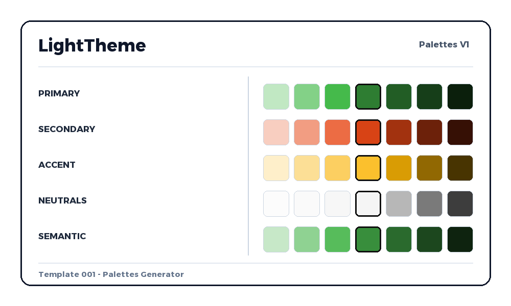
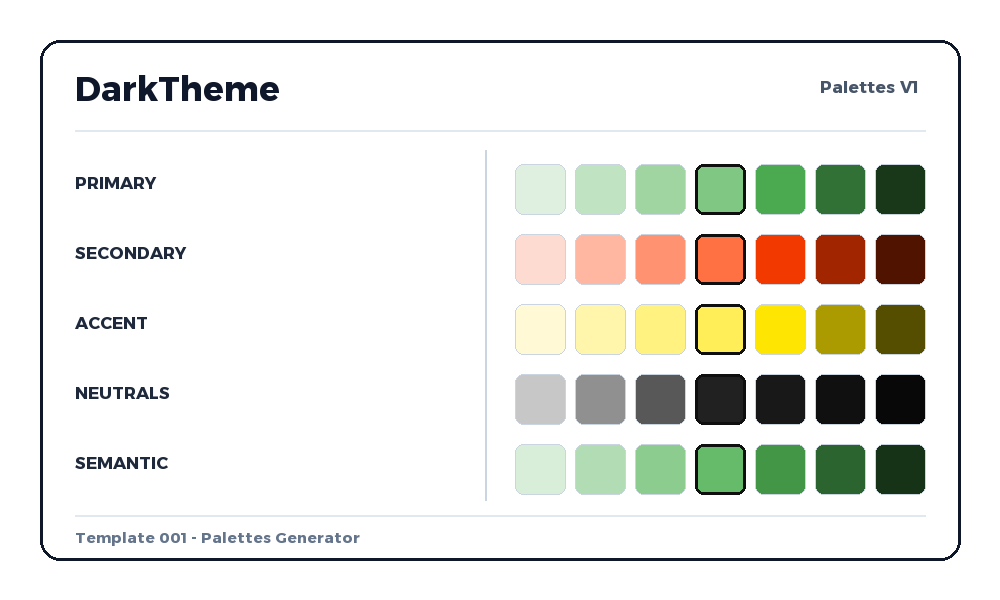

# 🎨 Palettes Generator

Extract professional **Light & Dark** UI color palettes from any image using Google Gemini — straight to PNG previews.


---

## 👀 Preview

| Light Theme | Dark Theme |
|:---:|:---:|
|  |  |

---

## ✨ What It Does

Pick an image → get 5 WCAG-compliant color tokens (PRIMARY, SECONDARY, ACCENT, NEUTRALS, SEMANTIC) for both themes → saved as ready-to-use PNGs.

---

## 📦 Install

```git
git clone https://github.com/ZyrenKing/Palettes-Generator.git
```

---

```cmd
cd palettes-generator
cd SourceCode
python -m venv .venv
.venv\Scripts\activate
pip install -r requirements.txt
```
---

Get a free key from [Google AI Studio](https://aistudio.google.com/app/apikey).

---

## 🚀 Run

```bash
python main.py
```

---

## 🗂 Files

| File | Role |
|---|---|
| `main.py` | GUI (CustomTkinter) — screens, flow, threading |
| `logic.py` | API calls, image → WEBP, palette PNG rendering |
| `StaticPrompt.md` | Strict system prompt forcing valid JSON output |
| `requirements.txt` | Dependencies |

---

## 🖼 Build EXE

```bash
pyinstaller --onedir --windowed --noconfirm --collect-all customtkinter --collect-all google.genai --name "Palettes Generator" main.py
```

---

## 📄 License

MIT © 2025 — free to use, modify, and distribute; keep the copyright notice, no warranty.
